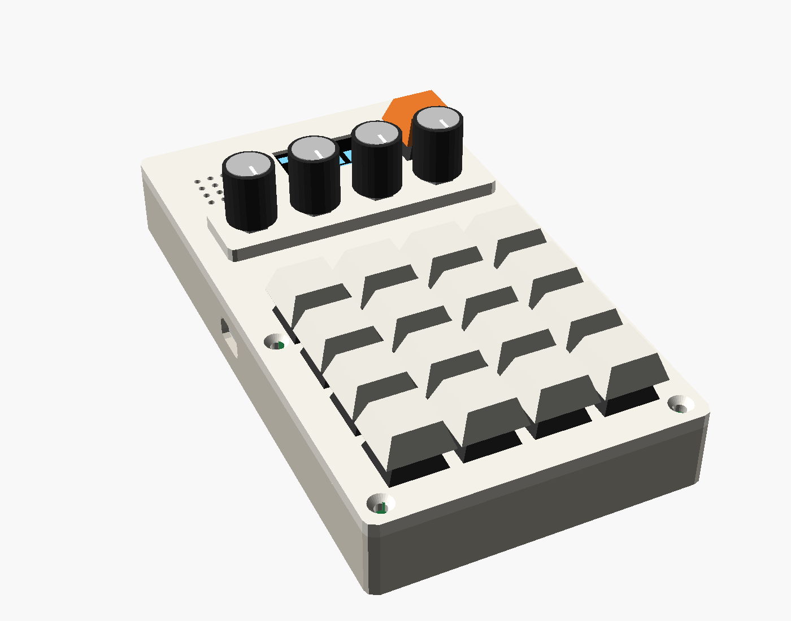
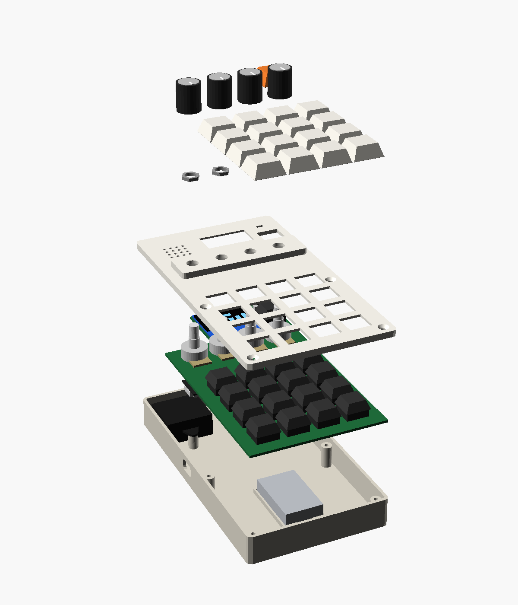
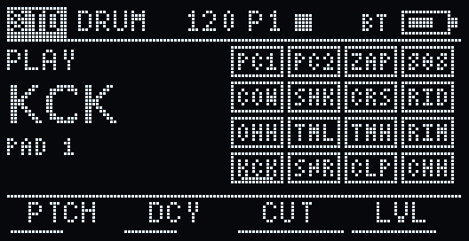
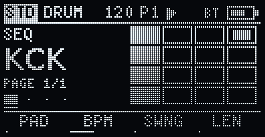
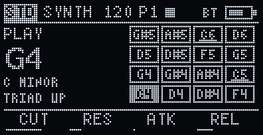
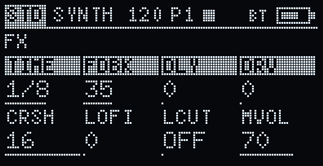

# XO-Hugbox

**A pocket groovebox and MIDI controller from XOXO Audio Labs.**
16 mechanical pads, 4 knobs, a little OLED, a speaker and a headphone jack, running on a battery.
Play it on its own, or use it as a USB/Bluetooth MIDI companion for XOXO Studio and the FM-1 Companion Studio.

<p align="center">
  
  
</p>

> **Status: prototype.** The hardware design is complete and the full firmware runs in the browser emulator, but no
> unit has been built yet. Expect changes once the first boards are assembled; see the [roadmap](#roadmap).

---

## What it does

- **Drums:** 16 sample pads with pitch, decay, filter, level, pan and choke groups. A built-in kit is generated at boot.
- **Sampling:** a built-in mic. Hold Shift + REC: a beep, then it records onto a pad until you let go; then trim, fade, normalise or reverse it in the same sample editor as XOXO Studio. Samples are kept on the flash.
- **Synth:** 6 voices, two oscillators (saw, square, sine, noise), 2-operator FM, a resonant filter with its own envelope, ADSR, analog-style drift and glide.
- **Chords and arpeggiator:** chords built from the scale (5th, triad, 7th, sus2, sus4, with inversions); the arp does up/down/up-down/random/as-played, 1/4 to 1/32 including triplets, 1–3 octaves, with latch.
- **Sequencer:** 16 steps × 4 pages = 64 steps, swing, live recording, and per-step velocity, pitch, gate and probability.
- **FX:** drive, bitcrush, sample-rate reduction, a tempo-synced ping-pong delay, and a low cut.
- **Modes:** Standalone, Controller (MIDI only) and Layered (both).
- **MIDI over USB and Bluetooth:** notes out and in, knob CCs in Controller mode, clock in or out, General MIDI drum notes.
- **Projects:** autosaves as you go, plus 8 save slots; copy/paste/clear sequencer pages, track mutes, tap tempo.

<p align="center">
  
  
  
  
</p>

## Try it now: the emulator

Download or clone the repo and open **[`sim/index.html`](sim/index.html)** in Chrome or Edge (double-click it). It's
one self-contained file. Click **Power on**, then play the pads with the mouse or the keys `1234 / QWER / ASDF / ZXCV`;
Shift is the Shift key. The built-in **Hugbox guide** panel walks through everything, from "how do I turn on chords"
to MIDI sync, and your projects are saved in the browser.

The emulator runs **the same C++ as the device** (`firmware/lib/hugbox_core`), compiled to WebAssembly with the real
display driver, so the screen and the sound match the hardware. See [`sim/README.md`](sim/README.md).

## Controls

| Control | What it does |
|---|---|
| Pads | Play drums, or synth notes in a scale (bottom-left = lowest). In SEQ, toggle steps. |
| Knobs | 4 parameters of the current page. Hold **Shift** for 4 more. Knobs "pick up" a value only once turned past it. |
| Shift + pad | Top row: PLAY · SEQ · SOUND · FX. Row 2: seq page 1–4. Row 3: DRUM · SYNTH · run/stop · rec. Bottom row: Standalone · Controller · Layered · Settings. |
| Double-tap Shift | Shows the shortcut map; tap a pad to jump there. |
| Hold a step + knob | Set that step's velocity, pitch, gate or probability. |
| SETTINGS pads | Tap S1–S8 to load, hold to save · copy/paste/clear page · mutes · tap tempo · MIDI panic. |

## Build one

Open the interactive 3D build guide, **[`docs/build-guide/index.html`](docs/build-guide/index.html)**. It shows every part
in place, explodes the model, and walks through the assembly in 13 steps with orientation, jumper and polarity notes.
It needs an internet connection to load three.js.

**Main parts:** Seeed XIAO ESP32-S3 · PCF8574T I/O expander · MAX98357A amp + 3 W speaker · PCM5102A DAC (headphone/line out) ·
1.3" SH1106 OLED · 4× B10K pots · 17× MX switches + 16× 1N4148 · 1100 mAh LiPo · 2-layer PCB · 3D-printed plate and shell.
Target: under $50 in parts. Full parts list, what to measure before ordering, PCB order notes and printing settings:
**[docs/hardware.md](docs/hardware.md)**.

## Repository layout

```
hardware/
  layout.py              single source of truth for every position and dimension
  pcb/                   KiCad 7 scripts, routed boards, gerbers
                         v1: xo_hugbox_gerbers.zip (order candidate)
                         v1.1: separate speaker data line (pending a breadboard test)
  mechanical/            plate + shell generators, STLs, assembly scene
firmware/
  lib/hugbox_core/       the instrument: UI, sequencer, chords/arp, synth, sampler, FX (shared with the emulator)
  src/hugbox/            board layer (inputs, OLED, I2S, flash, MIDI)    -> pio run -e hugbox
  src/bringup/           hardware bring-up test                          -> pio run -e bringup
  src/duali2s/           v1.1 speaker-line breadboard test               -> pio run -e duali2s
sim/                     browser emulator (WASM build of hugbox_core)
docs/
  build-guide/           interactive 3D build guide
  hardware.md            parts, ordering, printing, assembly, regenerating the design files
  firmware.md            firmware architecture, controls, projects, MIDI
  speaker-path-plan.md   board v1.1 plan and test checklist
  images/                renders and screen images
```

## Building from source

- **Firmware** (PlatformIO, Arduino-ESP32 core 3.x via pioarduino): `cd firmware && pio run -e hugbox -t upload`, then
  `pio device monitor`. Flash `-e bringup` first on a new board. Details: [docs/firmware.md](docs/firmware.md).
- **Emulator:** after changing `firmware/lib/hugbox_core`, run `sim/build_wasm.sh` (emscripten, Linux/WSL).
  See [`sim/README.md`](sim/README.md).
- **Hardware:** KiCad 7 Python scripts + Freerouting + OpenSCAD, all driven by `hardware/layout.py`.
  See [docs/hardware.md](docs/hardware.md#regenerating-the-hardware-files).

## Roadmap

1. ✅ UI: views, knob pages, shift layer, sequencer grid, modes
2. ✅ Synth + sample engine
3. ✅ Projects + sequencer extras
4. ✅ FX
5. ✅ USB + BLE MIDI
6. ⬜ Bring-up on real hardware, then order the PCB (v1 or v1.1)
7. ✅ Mic sampling + user samples on flash (in code and the emulator; not on hardware yet)

## Contributing

Issues and pull requests are welcome, especially build reports once you've assembled one. Keep `hardware/layout.py`
as the single source of truth, never hand-edit generated files, and rebuild both the firmware and the emulator when you
change `firmware/lib/hugbox_core` so they stay identical. [CLAUDE.md](CLAUDE.md) has the short version of the house rules.

## License

- **Hardware** (`hardware/`): [CERN-OHL-S-2.0](LICENSES/CERN-OHL-S-2.0.txt)
- **Software** (`firmware/`, `sim/`, build-guide code): [MIT](LICENSES/MIT.txt)
- **Docs and images:** [CC BY-SA 4.0](LICENSES/CC-BY-SA-4.0.txt)

See [LICENSE](LICENSE) for the details and [NOTICE.md](NOTICE.md) for third-party components.
© 2026 XOXO Audio Labs LLC.
